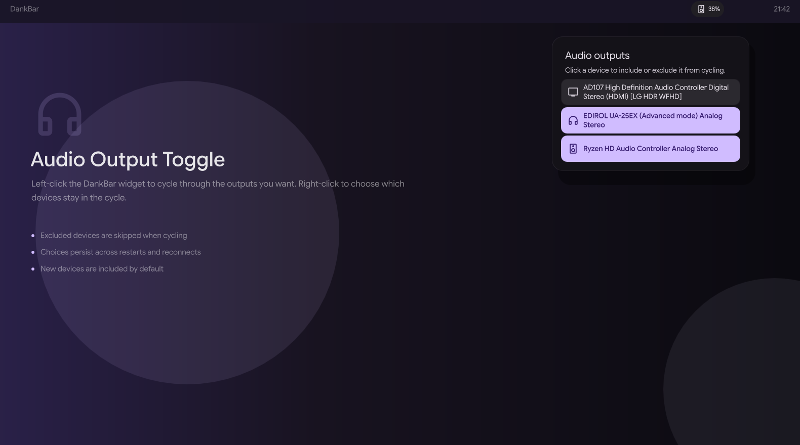

# Audio Output Toggle — DMS Plugin

Switch the active audio output directly from the DMS bar without opening audio
settings. Left-click to cycle between your chosen speakers, headphones or other
outputs. Right-click to open a device list and choose which outputs to include
in the cycle; preferences survive restarts and temporary disconnections.



## Features

- **Left-click** the widget to cycle through the audio outputs you have enabled.
- **Right-click** to open a compact output list and include or exclude devices
  from the cycle without changing the current output.
- Included devices use the active DMS highlight color; excluded devices use the
  normal inactive surface.
- Device-aware icon: headset, speaker, or TV based on the active output, with
  mute and zero-volume states.
- Toast notification when the output changes.
- Choices are stored by device name, so they survive DMS restarts and temporary
  disconnects. New devices are included by default.
- Works with any number of connected outputs, including none.

## Requirements

- DMS (DankMaterialShell) **2.0.0 or newer**.
- A working DMS audio backend (PipeWire on Linux).
- No external audio command-line tools are required. The widget uses DMS
  `AudioService` APIs and does not invoke `wireplumber`, `wpctl`, or `pactl`.

Tested with DMS 2.0.0 and Quickshell 0.3.2 on Hyprland.

## Installation

### From source (available now)

```bash
git clone https://github.com/lelabdev/dms-plugin-audio-output.git \
  ~/.config/dms/plugins/audioOutputToggle

dms ipc call plugins enable audioOutputToggle
```

### From the plugin registry (after registry approval)

The official registry entry is still being restored. Until it is published, use
the source installation above. Once the entry is available:

```bash
dms plugins install audioOutputToggle
dms ipc call plugins enable audioOutputToggle
```

After installing, add **Audio Output Toggle** in **Settings → Bar widgets** and
place it in your preferred bar section.

After pulling source updates:

```bash
dms ipc call plugins reload audioOutputToggle
```

## Usage

- **Left-click** cycles to the next enabled output and skips excluded devices.
- **Right-click** opens the output list. Click a device card to include or
  exclude it from the cycle. Clicking a card does not switch the current output.
- If every output is excluded, left-click does nothing and shows a reminder to
  re-enable an output from the right-click panel.
- Excluding a device keeps working across unplug/reconnect because preferences
  are keyed by the device's PipeWire node name rather than its list position.

## Uninstall

If installed from source:

```bash
dms ipc call plugins disable audioOutputToggle
rm -rf ~/.config/dms/plugins/audioOutputToggle
```

If installed from the plugin registry after its approval:

```bash
dms plugins uninstall audioOutputToggle
```

## License

MIT
